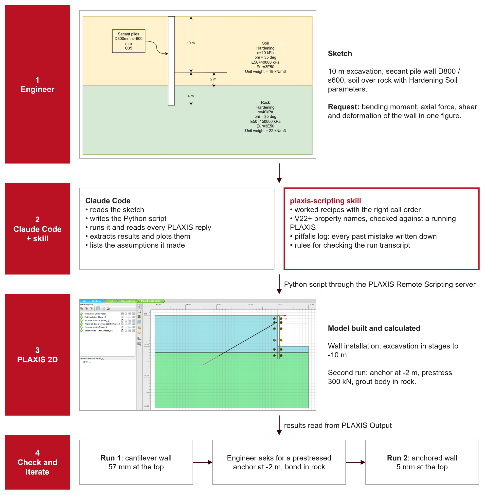

Lately I have been building a Claude skill for writing Plaxis Python scripts in the new (V22+) property style. Most of the work was checking names against a running Plaxis and writing down every mistake so it is not made twice.

The test in the video: I drew a 10 m excavation with a secant pile wall in draw.io and asked for the bending moments, axial forces, shear and deformations in one figure. It wrote the script, ran it in Plaxis 2D, read the results and plotted them. The cantilever moved 57 mm at the top, so I asked for a prestressed anchor at -2 m with the bond in rock. Second run: 5 mm.

It also listed what it had assumed (anchor spacing, prestress, how to read one of my dimensions), which is the part I check first.


